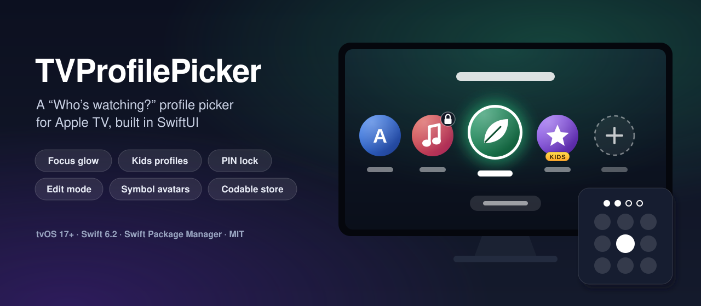
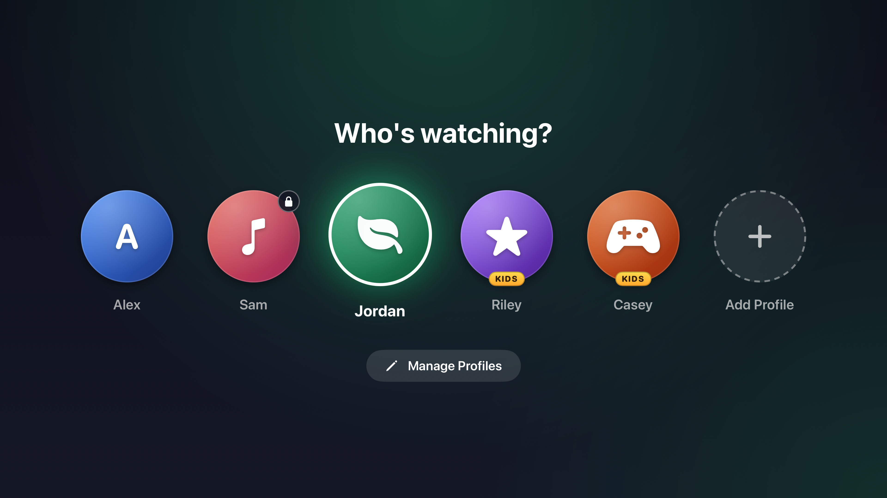
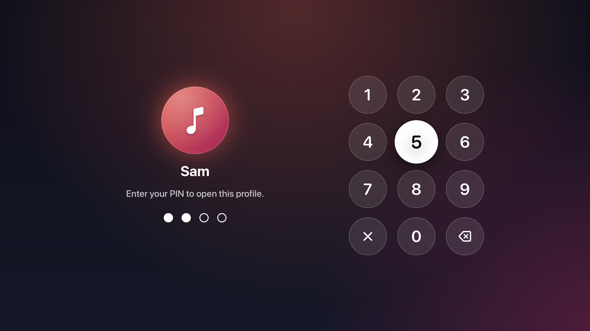
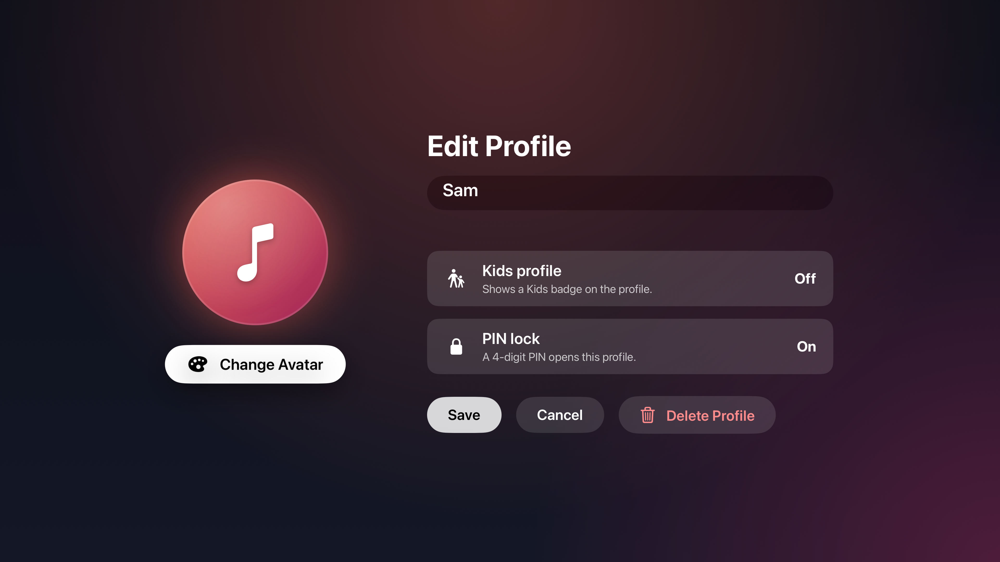
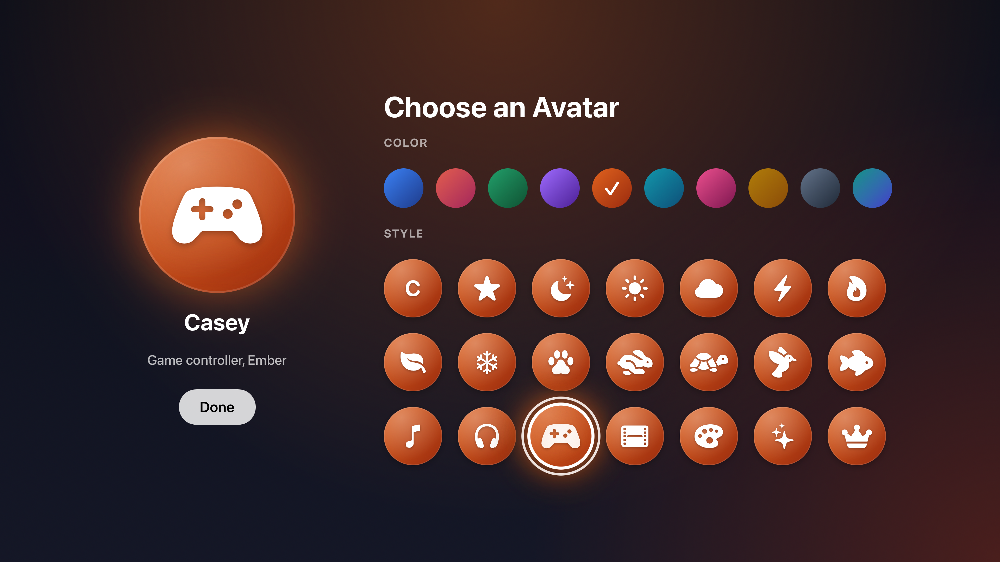

<p align="center">
  
</p>

<p align="center">
  <a href="https://github.com/halilozel1903/TVProfilePicker/actions/workflows/ci.yml"></a>
  
  
  
  
  <a href="LICENSE"></a>
</p>

**TVProfilePicker** is the "Who's watching?" screen for your Apple TV app, in SwiftUI. Profiles appear as round avatar tiles that grow and glow in their own color when focused. Kids profiles get a badge, locked profiles ask for a PIN on a keypad made for the Siri Remote (with a shake when it's wrong), and an edit mode lets people rename profiles, pick another avatar, set a PIN or delete a profile. Avatars are generated (initials or SF Symbols over a gradient), so there are no images to ship or download. Profiles live in a small `Codable` store that saves itself. No dependencies.

```swift
import TVProfilePicker

@State private var store = ProfileStore()           // saved in user defaults
@State private var current: Profile?

var body: some View {
    if let current {
        HomeView(profile: current)
    } else {
        ProfilePicker(store: store) { profile in
            current = profile                       // after the PIN, when the profile has one
        }
    }
}
```

## Screenshots

Captured by CI from the example app on an Apple TV 4K simulator. The profiles are a **demo household with generic made-up names** (Alex, Sam, Jordan, Riley and Casey) bundled with the example app; Sam's profile is locked with the demo PIN 1234.

| Picker | PIN |
| :---: | :---: |
|  |  |

| Edit | Avatar |
| :---: | :---: |
|  |  |

## Features

- **A picker that feels at home on tvOS**: focusable tiles that scale up with a white ring and a glow in the avatar's color, a backdrop that takes on the focused profile's colors, focus starting on the profile chosen last, and focus sections so the remote moves naturally between the row and the buttons.
- **Generated avatars**: initials or one of 20 SF Symbols over 10 gradient palettes, all checked for white-on-color contrast. No emoji, no images, nothing to download. New profiles get a palette picked from their name, so a household gets different colors without choosing.
- **Kids profiles**: a Kids badge on the tile and in the editor; `Profile.isKids` for your app to switch catalogs.
- **PIN lock**: a 3 by 4 keypad for the Siri Remote. A wrong PIN shakes the dots and says how many tries are left; after five, the profile is locked for 30 seconds with a countdown (`PINAttemptPolicy`). PINs are stored as salted SHA-256 hashes, never as digits. Creating a PIN asks for it twice.
- **Edit mode**: Manage Profiles marks every tile with a pencil. Choosing one opens the editor (after its PIN, for a locked profile): rename, change the avatar, toggle Kids, set, change or remove the PIN, delete. Add Profile opens the same editor for a new profile.
- **Codable profile store**: `ProfileStore` is an `@Observable` model that validates names (empty, too long, duplicates ignoring case and accents), enforces a profile limit, and saves a `ProfileArchive` after every change, to user defaults, a JSON file, memory, or your own `ProfileStorage`.
- **Accessibility**: each tile reads as one element ("Riley, kids profile", "Sam, locked with a PIN") with a hint; keys, palettes and avatar options have spoken names and selected traits; the PIN dots read "2 of 4 digits entered"; wrong PINs and lockouts are announced; Reduce Motion turns the scaling and the shake into a ring and a red flash.
- **Safe on a TV**: content stays inside the safe area, clear of overscan, while backdrops run to the edges. Rows that would overflow shrink, then scroll inside padding with clipping on, so focused tiles have room to grow and nothing draws outside the scroll view.

## Installation

In Xcode choose **File › Add Package Dependencies…** and enter:

```
https://github.com/halilozel1903/TVProfilePicker
```

Or add it to `Package.swift`:

```swift
dependencies: [
    .package(url: "https://github.com/halilozel1903/TVProfilePicker", from: "1.0.0")
],
targets: [
    .target(name: "MyTVApp", dependencies: ["TVProfilePicker"])
]
```

## Usage

### The store

```swift
let store = ProfileStore(
    storage: UserDefaultsProfileStorage(),             // the default
    initialProfiles: [Profile(name: "Alex")],          // used when nothing is saved yet
    maxProfiles: 6,
    maxNameLength: 20,
    pinPolicy: .standard                               // 5 tries, then 30 seconds
)

let riley = try store.add(name: "Riley", avatar: .symbol("star.fill", .grape), isKids: true)
try store.add(name: "Sam", pin: ProfilePIN("1234"))   // avatar picked from the name
try store.rename(riley.id, to: "Riley J.")
try store.setAvatar(.initials(.lagoon), for: riley.id)
try store.setPIN(nil, for: riley.id)
try store.move(riley.id, to: 0)
try store.delete(riley.id)

do {
    try store.add(name: "alex")
} catch {
    print(error.localizedDescription)                  // "Another profile already has this name."
}
```

On Apple TV, apps have no persistent Documents or Application Support folder (the system may purge it), so the default storage is user defaults; a few profiles take a couple of kilobytes. To share profiles between devices, conform a type to `ProfileStorage` and back it with iCloud key-value storage or your server:

```swift
struct CloudProfileStorage: ProfileStorage {
    func load() throws -> ProfileArchive? {
        try NSUbiquitousKeyValueStore.default.data(forKey: "profiles").map(ProfileArchive.init(jsonData:))
    }
    func save(_ archive: ProfileArchive) throws {
        NSUbiquitousKeyValueStore.default.set(try archive.jsonData(), forKey: "profiles")
    }
}
```

### The picker

```swift
@State private var isEditing = false

ProfilePicker(
    store: store,
    title: "Who's watching?",
    avatarSize: 200,             // 6 tiles fit at this size; more shrink, then scroll
    allowsEditing: true,         // Add Profile and Manage Profiles
    showsBackground: true,       // backdrop tinted by the focused profile
    isEditing: $isEditing        // optional; the picker keeps its own otherwise
) { profile in
    open(profile)
}
```

The remote's Back (Menu) button leaves edit mode; outside edit mode it is left to the system.

### The screens on their own

Every screen the picker presents is public, for flows of your own:

```swift
// Ask for a profile's PIN.
PINPadView(unlocking: profile,
           lockedUntil: store.lockoutEnd(for: profile.id),
           verify: { store.verifyPIN($0, for: profile.id) },
           onUnlock: { open(profile) },
           onCancel: { dismiss() })

// Create a PIN (typed twice).
PINPadView(creatingPINFor: "Sam", avatar: avatar,
           onCreate: { pin in try? store.setPIN(pin, for: id) },
           onCancel: { dismiss() })

// Add (profileID: nil) or edit a profile.
ProfileEditorView(store: store, profileID: profile.id) { dismiss() }

// Choose an avatar.
AvatarChooserView(name: "Casey", selection: $avatar) { dismiss() }

// Building blocks.
AvatarView(profile: profile, size: 160)
KidsBadge()
ProfileBackdrop(accent: .forest)
Button { … } label: { ProfileTileLabel(profile: profile) }
    .buttonStyle(FocusLiftButtonStyle(focusedScale: 1.12))
```

### PINs

```swift
let pin = try ProfilePIN("0427")        // 4 to 8 digits; throws ProfilePINError.invalidFormat
pin.matches("0427")                     // true
pin.hash                                // salted SHA-256, hex

switch store.verifyPIN("1111", for: id) {
case .accepted: break
case .rejected(let remainingAttempts): break
case .lockedOut(let until): break
}
```

A profile PIN keeps kids out of a parent's profile; it is not account security. Four digits can be guessed, which is why wrong attempts are limited. Keep real credentials in the Keychain.

## API

| Type | What it is |
| --- | --- |
| `ProfilePicker` | The "Who's watching?" screen: tiles, Add Profile, Manage Profiles, PIN and editor flows |
| `ProfileStore` | `@Observable` list of profiles: add, save draft, rename, avatar, kids, PIN, move, delete, select, verify PINs |
| `Profile` | `id`, `name`, `avatar`, `isKids`, `pin`, `createdAt`; `isLocked`, `initials`, `accessibilitySummary` |
| `ProfileDraft` | The editable fields, saved with `store.save(_:for:)` |
| `Avatar` | `.initials(palette)` or `.symbol(name, palette)`; `suggested(for:)`, `initials(from:)` |
| `AvatarPalette` | 10 gradients (`ocean`, `sunset`, `forest`, `grape`, `ember`, `lagoon`, `rose`, `gold`, `slate`, `aurora`) |
| `AvatarSymbol` | The 20 symbols the chooser offers, with spoken names |
| `ProfilePIN` | Salted SHA-256 PIN of 4 to 8 digits; `matches(_:)` |
| `PINEntry` | Digits typed on a pad: `append`, `deleteLast`, `clear`, `isComplete`, `code` |
| `PINAttemptPolicy`, `PINAttempts`, `PINVerification` | Wrong-PIN limits and outcomes |
| `ProfileArchive` | The Codable snapshot the store saves (`jsonData()`, `init(jsonData:)`) |
| `ProfileStorage` | `UserDefaultsProfileStorage`, `FileProfileStorage`, `InMemoryProfileStorage` or your own |
| `ProfileStoreError` | `emptyName`, `nameTooLong`, `duplicateName`, `limitReached`, `profileNotFound` |
| `PINPadView` | Unlock or create a PIN |
| `ProfileEditorView` | Add or edit a profile |
| `AvatarChooserView` | Palettes and styles with a live preview |
| `AvatarView`, `KidsBadge`, `ProfileTileLabel`, `AddProfileTileLabel`, `ProfileBackdrop`, `FocusLiftButtonStyle` | Building blocks |

## Example app

The `Example` folder contains *Profiles*, an Apple TV app with the demo household (generic names, demo PIN 1234 for Sam). It starts at the picker, opens a placeholder home screen for the chosen profile, and has a Switch Profile button to come back. Profiles are saved in user defaults, so changes survive a relaunch.

The project uses [XcodeGen](https://github.com/yonaskolb/XcodeGen) so no project file has to live in the repo:

```bash
brew install xcodegen
cd Example && xcodegen generate
open TVProfilePickerDemo.xcodeproj
```

Run `ProfilesTV` on an Apple TV simulator. Launch with `-screenshot picker|pin|edit|avatar` to open the fixed scenes CI captures for the screenshots above (in memory, so they never touch your saved profiles).

## Requirements

- Xcode 26 or later (Swift 6.2 toolchain)
- tvOS 17+ (macOS 14+ only to run the tests; the views are made for Apple TV)

## Contributing

Issues and pull requests are welcome. Please run the tests before opening a PR:

```bash
swift test
bash scripts/test.sh tvOS
```

## License

TVProfilePicker is available under the MIT license. See [LICENSE](LICENSE).
